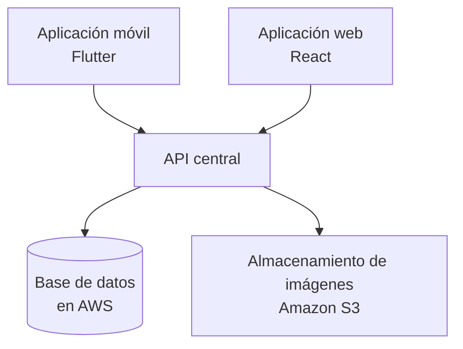

# 🐑 OviApp

### Gestión inteligente de la producción ovina

**Una plataforma para digitalizar, organizar y analizar la información de la producción ovina.**

---

## ¿Qué es OviApp?

**OviApp** es un proyecto de software orientado a facilitar la administración de ranchos y el seguimiento del ganado ovino. Busca centralizar los registros productivos, reproductivos y económicos en una plataforma accesible para productores y otros participantes del sector.

La solución contempla una aplicación móvil para las operaciones en campo y una aplicación web para la gestión y consulta de información por parte de la asociación.

> **Estado:** proyecto en desarrollo. Las funcionalidades y decisiones técnicas descritas representan el alcance previsto y pueden evolucionar.

## Objetivos

- Digitalizar los registros de animales, nacimientos, destetes y crecimiento.
- Facilitar el seguimiento de indicadores productivos y reproductivos.
- Registrar información económica para apoyar el análisis de ingresos y gastos.
- Ofrecer acceso a la información según el rol y los permisos de cada usuario.
- Reducir la dependencia de registros manuales y facilitar la toma de decisiones basada en datos.

## Usuarios y roles

| Rol | Alcance previsto |
| --- | --- |
| **Asociación** | Consulta y gestión de información de los ranchos asociados, según sus atribuciones. |
| **Dueño** | Administración de la información de su rancho y de los permisos de sus trabajadores. |
| **Trabajador** | Registro y consulta de información según los permisos otorgados. |
| **Veterinario** | Acceso a funciones e información relacionadas con su trabajo, por definir. |

## Arquitectura propuesta

| Componente | Tecnología propuesta | Propósito |
| --- | --- | --- |
| Aplicación móvil | Flutter / Dart | Operaciones de campo para dueños, trabajadores y veterinarios. |
| Aplicación web | React | Interfaz para la asociación. |
| Backend | API centralizada | Reglas de negocio, autenticación, autorización e integración. |
| Base de datos | Servicio en AWS, por definir | Persistencia de información. |
| Imágenes | Amazon S3 | Almacenamiento de evidencias y fotografías. |

Se contempla el uso de almacenamiento local en la aplicación móvil para capturas pendientes de sincronización, sujeto a validación técnica.

## Organización de repositorios

El proyecto se divide en cuatro áreas de trabajo:

| Repositorio | Responsabilidad |
| --- | --- |
| **Mobile** | Aplicación móvil desarrollada con Flutter. |
| **Web** | Aplicación web desarrollada con React. |
| **API** | Backend, reglas de negocio y acceso a datos. |
| **Infraestructura y documentación** | Arquitectura, especificaciones, despliegue y documentación técnica. |

Los nombres definitivos y enlaces de los repositorios se incorporarán conforme se publiquen.

## Principios del proyecto

- **Seguridad:** control de acceso por roles, permisos y contexto de rancho.
- **Mantenibilidad:** separación de responsabilidades entre clientes, API y persistencia.
- **Escalabilidad:** diseño orientado a incorporar más ranchos y productores.
- **Usabilidad:** interfaces prácticas para el trabajo cotidiano.
- **Integridad de datos:** trazabilidad y validación de los registros.
- **Eficiencia de costos:** infraestructura ajustada a las necesidades de cada etapa.

## Estado del desarrollo

OviApp se encuentra en fase de análisis, diseño y desarrollo inicial. El equipo trabaja en la definición de requisitos, modelos de datos, arquitectura y funcionalidades prioritarias.

---

**OviApp · Tecnología al servicio de la producción ovina**

